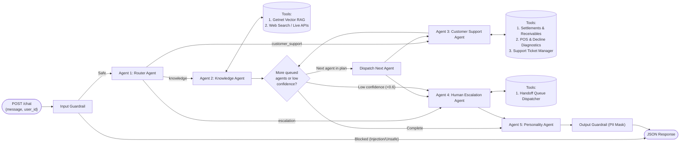

# Design: Getnet Multi-Agent Support System

## Context

This greenfield repository implements the **Getnet AI Hardcore Engineer Multi-Agent Support System** challenge (`See proposal.md - Why`). The system must be developed using Spec-Driven Development, packaged as a containerized HTTP service, and capable of handling three distinct categories of requests:
1. **Getnet Product & Institutional Knowledge** (via RAG grounded on `https://www.getnet.net/en` and Getnet product documentation).
2. **General-Purpose Real-Time Queries** (via Web Search for weather forecasts, currency exchange rates, etc.).
3. **Personalized Customer Support** (via `user_id`-scoped tools for settlements, POS terminal connectivity, transaction decline errors, and support tickets).

Additionally, the architecture incorporates **Input/Output Guardrails**, a **4th Custom Human Escalation Agent**, a **Personality Synthesis Agent** (matching the challenge workflow diagram), and **Production Observability & Automated Scenario Evaluation**.

## Goals / Non-Goals

**Goals:**
- Deliver a deterministic, observable **LangGraph state-machine orchestration** where each agent (`Router`, `Knowledge`, `CustomerSupport`, `Escalation`, `Personality`) is an isolated, unit-testable node reading and writing to a typed `AgentState`.
- Ensure **zero-flake RAG ingestion and retrieval**: scrape live Getnet pages (`https://www.getnet.net/en` and product pages) while bundling a curated high-fidelity Getnet knowledge corpus (`data/knowledge_base/`) so offline builds, CI tests, and anti-bot firewalls never break RAG accuracy.
- Ensure **resilient Web Search**: use `duckduckgo-search` (`ddgs`) with an optional Tavily API key and a live public HTTP API fallback (`open-meteo.com` for weather and `awesomeapi.com.br` / `frankfurter.app` for EUR/BRL exchange rates) so real-time queries never fail due to search rate-limits inside Docker containers.
- Provide **full observability, alerting, and visual inspection out of the box**: structured JSON logs (`structlog`), native **LangSmith** tracing & dataset integration (`langsmith` / `LANGCHAIN_TRACING_V2`) + optional Langfuse export, local trace/metrics/alerts endpoints (`GET /traces`, `GET /metrics`, `GET /alerts`), an automated **SLO & Security Alerting Engine**, and a built-in **Interactive Visual Dashboard (`GET /dashboard`)** for linear step-by-step workflow inspection and live testing.
- Provide an **Automated Evaluation Suite & Dataset** (`data/eval_dataset.json` + `scripts/evaluate.py` + `pytest` regression suite) that runs all 10 challenge scenarios + multi-agent hybrid and adversarial cases, scoring routing accuracy, tool invocation accuracy, and rubric/LLM-as-a-judge faithfulness (locally and via LangSmith Datasets).

**Non-Goals:**
- Connecting to live internal Santander/Getnet core banking mainframes (merchant data for `cliente1988` and peer test personas is served from a deterministic local repository `data/merchants.json`).
- Multi-turn persistent WebSocket streaming (requests are stateless HTTP `POST` calls keyed by `user_id`, with optional in-memory session history).

## Decisions

### 1. Orchestration Framework: LangGraph StateGraph over Autonomous ReAct Loops
- **Decision**: Use **LangGraph (`StateGraph`)** with explicit typed state (`OrchestrationState`) and structured output (`with_structured_output` / Pydantic models) for the Router Agent.
- **Rationale**: The challenge requires clear inter-agent communication, sequential multi-agent routing when a query spans multiple domains, conditional handoff to a Human Escalation Agent, and a final pass through the Personality Agent. A DAG/StateGraph provides explicit control flow, deterministic loop bounds, and native node-level tracing.
- **Alternatives Considered**:
  - *CrewAI / AutoGen*: Higher overhead, opaque autonomous loops that increase latency and token cost, harder to unit-test individual transitions.
  - *Raw async function chaining*: Simpler initially, but lacks standardized state reducers, conditional edge visualization, and checkpointing.



### 2. Hybrid 3-Layer RAG Pipeline (`Ingestion → Storage → Retrieval → Dynamic Fallback → Generation`)
- **Decision**:
  - **Layer 1 — Multi-Source Live Web Ingestion**: `httpx` + `BeautifulSoup4` scraper targeting both the Global institutional portal (`https://www.getnet.net/en`) and Getnet Brasil official product/FAQ pages (`https://site.getnet.com.br/maquininhas/`, `https://site.getnet.com.br/link-de-pagamento/`, `https://site.getnet.com.br/duvidas/`), plus a CLI re-ingestion trigger (`python scripts/ingest_kb.py`) to refresh indexed pages at any time before or after deployment.
  - **Layer 2 — Curated Ground-Truth Corpus (`data/knowledge_base/getnet_products.md`)**: Because Getnet's commercial pages dynamically rotate campaign banners and scatter technical specs across subpages, Help Center (`duvidas`), Santander portals, and official videos, we bundle a verified markdown corpus covering the complete terminal lineup (*Get Tap*, *Get Mini*, *Get Lite*, *Get Clássica*, and *Get Smart*) and official product rules (*Pix* bank domicile requirements, *Antecipação de Recebíveis* punctual vs. automatic, *Crediário* up to 48 installments with 2-business-day merchant settlement, and *Link de Pagamento / GetPay* via WhatsApp).
  - **Layer 3 — Live Domain-Scoped Search Fallback for Newly Launched Products**: If a user asks about a newly launched Getnet product, campaign, or feature (e.g., launched right before the submission deadline) that has low semantic similarity or no direct entity match in ChromaDB, the Knowledge Agent automatically triggers a live web search scoped to official Getnet sources (`site:site.getnet.com.br` / `Getnet <query>`) via its Web Search tool to retrieve fresh information on the fly.
  - **Chunking**: Semantic markdown header splitting + recursive character splitting (`chunk_size=700`, `chunk_overlap=120`) preserving `source_url`, `section`, and `product_tag` metadata.
  - **Storage**: **ChromaDB** in persistent local directory (`data/chroma_db`) using `OpenAIEmbeddings` (`text-embedding-3-small`), with automatic deterministic fallback to local embeddings/hybrid keyword-cosine scorer when running unit tests without an API key.
  - **Retrieval**: Top-$k$ ($k=4$) similarity search exposed as the `retrieve_getnet_knowledge` tool on the Knowledge Agent, enriched by the live Getnet search fallback when local chunks do not cover a new product entity.
- **Rationale**: Empirical inspection of Getnet's web presence shows that `getnet.net/en` only holds global corporate info, while `site.getnet.com.br` disperses terminals (*Get Lite* and *Get Clássica* on the main showcase; *Get Smart*, *Get Mini*, and *Get Tap* across subpages and Help Center). Combining multi-URL live scraping, a curated ground-truth corpus of all 5 terminals + financial products, and a live web search fallback guarantees both zero-flake determinism on the 10 challenge scenarios and real-time adaptability if Getnet releases a new product tomorrow.

### 3. Resilient Web Search Tool (`web_search_general`)
- **Decision**: Implement `web_search_general` with a tiered provider strategy:
  1. **Domain-Specific Live Public APIs (Zero-Key, High Reliability)**: If the query asks for weather (e.g., Porto Alegre) or currency exchange rates (e.g., Euro today), enrich search results with live data from Open-Meteo (`api.open-meteo.com`) and Frankfurter/AwesomeAPI (`api.frankfurter.app`), alongside web search snippets.
  2. **General Web Search**: Use DuckDuckGo (`duckduckgo-search`) or Tavily API (if `TAVILY_API_KEY` is set).
- **Rationale**: DuckDuckGo HTML scraping occasionally rate-limits datacenter/Docker IPs. Backing weather and FX queries with open public REST APIs ensures the 2 external test scenarios (`Porto Alegre weather` and `Euro exchange rate`) always return real-time, accurate data in any environment.

### 4. Customer Support Agent & Merchant Data Store (`user_id`-Scoped)
- **Decision**: Store rich merchant profiles and telemetry in `data/merchants.json` (with `cliente1988` pre-populated with realistic POS terminals, yesterday's sales settlement batch, a recent declined transaction with ISO-8583 code `51 - Insufficient Funds` / `05 - Do Not Honor` + terminal Wi-Fi/GPRS status, and ticket history) and expose **3 Pydantic-validated tools**:
  1. `get_merchant_settlement_status(user_id: str)`: Returns yesterday's sales volume, scheduled deposit date/time, bank account details, and receivable status.
  2. `diagnose_pos_and_transactions(user_id: str, issue_type: str)`: Returns registered terminal model (*Get Smart* / *Get Clássica*), SIM/Wi-Fi telemetry, last transaction decline error code & cause, and model-specific troubleshooting steps.
  3. `manage_support_ticket(user_id: str, issue_summary: str, action: str)`: Lists open tickets or creates a new technical support / terminal swap ticket.
- **Rationale**: Exceeds the `>= 2 tools` requirement and directly maps to all customer support test scenarios in the challenge PDF while demonstrating realistic fintech domain modeling.

### 5. Observability, LangSmith Suite, Alerting & Evaluation Architecture
- **Decision**:
  - **Structured Logging**: Configure `structlog` to output JSON lines with `timestamp`, `level`, `trace_id`, `user_id`, `agent`, `event`, `latency_ms`, and `token_usage`.
  - **Dual Tracing (LangSmith Cloud + Local Docker Inspector)**:
    1. **LangSmith Native Integration**: Enable `LANGCHAIN_TRACING_V2`, `LANGCHAIN_API_KEY`, and `LANGCHAIN_PROJECT` in `src/config/settings.py` and decorate custom orchestration spans with `langsmith.traceable` so every LangGraph node, prompt, tool call, token count, and latency is automatically visualized in LangSmith (and optionally forwarded to Langfuse).
    2. **Local Trace & Metrics Store**: Wrap every graph node and tool call in a `TraceRecorder` context manager that persists spans locally (`logs/traces.jsonl`) so evaluators running the Docker container without cloud API keys can still inspect traces via `GET /traces/{trace_id}` and `GET /metrics`.
  - **Production Alerting Mechanism (`GET /alerts`)**: Implement an SLO & Security Alerting monitor inside `src/observability/tracer.py` that evaluates every request and fires structured alerts when:
    1. *Latency SLO Breach*: End-to-end latency exceeds `5000ms` (`HIGH_LATENCY_ALERT`).
    2. *Guardrail Security Incident*: Input guardrail blocks a prompt-injection or unsafe attempt (`SECURITY_GUARDRAIL_ALERT`).
    3. *Escalation / Low-Confidence Spike*: A request drops below confidence threshold `< 0.60` or triggers human handoff (`HUMAN_HANDOFF_ALERT`).
  - **Visual Explainer & Live Dashboard (`GET /dashboard`)**: Serve a clean, self-contained HTML visual explainer and live observability dashboard directly from FastAPI (`GET /dashboard`) showing linear step-by-step message workflows, agent architecture, real-time metrics/alerts, and an interactive scenario tester.
  - **Automated Evaluation Dataset & Regression Suite (`data/eval_dataset.json` + `scripts/evaluate.py` + `pytest`)**: Runs the 10 challenge scenarios + multi-agent hybrid cases + guardrail adversarial tests (locally and optionally synced to a LangSmith Dataset), validating:
    1. *Route Accuracy*: Did the Router pick the expected agent(s) in order?
    2. *Tool Accuracy*: Did the specialized agent invoke the right tool (`retrieve_getnet_knowledge`, `web_search_general`, `get_merchant_settlement_status`, `diagnose_pos_and_transactions`, `manage_support_ticket`)?
    3. *Answer Groundedness & Completeness*: Does the final response address the merchant's question accurately against ground-truth rubrics?

### 6. Project Directory Structure

```text
getnet/
├── openspec/                        # Spec-Driven Development artifacts
│   ├── config.yaml
│   ├── specs/
│   └── changes/
│       └── multi-agent-support-system/
│           ├── proposal.md
│           ├── design.md
│           ├── tasks.md
│           └── specs/
├── src/
│   ├── __init__.py
│   ├── main.py                      # FastAPI entrypoint
│   ├── config/
│   │   └── settings.py              # Pydantic Settings (.env configuration)
│   ├── api/
│   │   ├── routes.py                # POST /chat, POST / (alias), GET /health, GET /metrics, GET /traces
│   │   └── schemas.py               # Request/Response Pydantic contracts
│   ├── orchestration/
│   │   ├── state.py                 # LangGraph OrchestrationState schema
│   │   └── graph.py                 # Multi-agent workflow graph builder & runner
│   ├── agents/
│   │   ├── router_agent.py          # Agent 1: Intent analysis & multi-agent routing plan
│   │   ├── knowledge_agent.py       # Agent 2: RAG + Web Search specialist
│   │   ├── support_agent.py         # Agent 3: Customer Support specialist with >=3 tools
│   │   ├── escalation_agent.py      # Agent 4 (Bonus): Human Escalation & Handoff specialist
│   │   └── personality_agent.py     # Agent 5: Brand voice & response synthesis
│   ├── rag/
│   │   ├── ingest.py                # Scraper (getnet.net/en) + markdown loader + chunker
│   │   └── vector_store.py          # ChromaDB indexing & semantic retrieval
│   ├── tools/
│   │   ├── knowledge_tools.py       # retrieve_getnet_knowledge, web_search_general
│   │   ├── support_tools.py         # settlement lookup, POS/decline diagnostics, ticket tool
│   │   └── escalation_tools.py      # handoff ticket & operator queue dispatch
│   ├── guardrails/
│   │   └── validator.py             # Input prompt-injection/safety check & Output PII masker
│   └── observability/
│       ├── logger.py                # structlog JSON configuration
│       └── tracer.py                # Span collector, metrics aggregator & optional Langfuse exporter
├── data/
│   ├── knowledge_base/              # Curated Getnet product documentation + scraped cache
│   └── merchants.json               # Mock merchant database (including cliente1988)
├── scripts/
│   ├── ingest_kb.py                 # CLI to trigger RAG ingestion
│   └── evaluate.py                  # Automated 10-scenario evaluation & benchmark report
├── tests/
│   ├── conftest.py
│   ├── unit/
│   │   ├── test_guardrails.py
│   │   ├── test_tools.py
│   │   ├── test_rag.py
│   │   └── test_router.py
│   └── integration/
│       ├── test_api_endpoints.py
│       └── test_challenge_scenarios.py
├── Dockerfile
├── docker-compose.yml
├── pyproject.toml
├── requirements.txt
├── .env.example
└── README.md
```

## Risks / Trade-offs & Architectural Defense Playbook

| # | Architectural Decision | Chosen Approach | Alternative Rejected | Trade-off Accepted & Production Justification |
| :--- | :--- | :--- | :--- | :--- |
| **1** | **Multi-Agent Orchestration** | **LangGraph (`StateGraph`)** with explicit typed `OrchestrationState` & Pydantic structured routing | Open-ended autonomous loops (*CrewAI*, *AutoGen*, raw ReAct) | **Trade-off**: Less free-form agent chatter.<br>**Gain**: Zero infinite loops, deterministic sequential multi-agent handoff, predictable token cost, and low latency (~2–4s) required by financial grade SLAs. |
| **2** | **5-Agent Topology (including Personality & Escalation)** | `Router` → `Knowledge` / `CustomerSupport` / `Escalation (4th Bonus)` → `Personality` | 3 agents returning raw tool outputs directly | **Trade-off**: One extra synthesis step.<br>**Gain**: Matches the official challenge architecture diagram, unifies multi-agent responses into a single empathetic Getnet brand voice, and cleanly handles low-confidence human handoff. |
| **3** | **3-Layer Zero-Flake RAG + Embedded ChromaDB** | Live multi-URL scraper (`getnet.net/en` + `site.getnet.com.br`) + curated ground-truth corpus (all 5 POS models) + live domain web-search fallback | Pure live scraping on startup or external cloud Vector DB (*Pinecone*/*Milvus*) | **Trade-off**: Maintaining a curated baseline alongside the live scraper.<br>**Gain**: Immune to bank WAF (`HTTP 403`) in Docker, covers dispersed product pages (*Get Tap*, *Get Mini*, *Get Lite*, *Get Clássica*, *Get Smart*), discovers newly launched products via live fallback, and runs self-contained in one container. |
| **4** | **Tiered Web Search Tool** | Live public REST APIs (*Open-Meteo* for weather, *AwesomeAPI/Frankfurter* for EUR FX) + *DuckDuckGo/Tavily* search | Raw *DuckDuckGo* HTML scraping only | **Trade-off**: Domain-specific enrichment logic inside the search tool.<br>**Gain**: Eliminates Docker IP rate-limiting (`HTTP 202`) and prevents outdated news snippets from returning stale Euro exchange rates. |
| **5** | **Hybrid Zero-Latency Guardrails (PCI/PII)** | Deterministic input prompt-injection filter + output PCI-DSS PAN/CPF masking (<2ms) + confidence-based escalation (<0.60) | Extra LLM moderation calls on every input and output | **Trade-off**: Pattern/heuristic rules instead of full semantic LLM judge on every turn.<br>**Gain**: Zero added latency or token cost while enforcing strict payment-industry (PCI/LGPD) data masking. |
| **6** | **Dual Observability, Alerting & Visual Dashboard** | **LangSmith** (`LANGCHAIN_TRACING_V2` + Datasets) + local `GET /traces`, `GET /metrics`, `GET /alerts`, and `GET /dashboard` | Cloud-only tracing requiring evaluator login | **Trade-off**: Maintaining lightweight in-memory/JSONL ring buffer alongside LangSmith.<br>**Gain**: You showcase rich LangSmith dashboards in the video, while the evaluator gets an out-of-the-box visual dashboard, traces, and SLO alerts inside Docker with zero setup. |

### Key Risks & Mitigations
- **[Risk] External Website Blocking During Live Scraping (`https://www.getnet.net/en`)** → **Mitigation**: Use custom User-Agent headers, timeout handling, and merge live scraped content with a pre-verified local corpus (`data/knowledge_base/`) plus live domain search fallback so RAG indexing always succeeds and covers both global institutional pages and Brazilian product specifics (*Get Tap*, *Get Mini*, *Get Lite*, *Get Clássica*, *Get Smart*, *Pix*, *Crediário*, *Antecipação*, *Link de Pagamento*).
- **[Risk] LLM API Key Absence During Automated CI or Offline Evaluation** → **Mitigation**: Abstract LLM and embedding initialization behind a factory that uses OpenAI (`gpt-4o-mini` + `text-embedding-3-small`) when `OPENAI_API_KEY` is provided, and provides a deterministic fallback mode (`LLM_PROVIDER=mock` or auto-fallback in tests) so `pytest` and Docker verification run reliably even before an API key is injected.
- **[Risk] Multi-Agent Latency Overhead** → **Mitigation**: Use `gpt-4o-mini` with low temperature (`0.0` for routing/tools, `0.2` for synthesis) and concise structured prompts so end-to-end execution completes in 1.5–4 seconds.

## Migration Plan

1. Initialize project structure, dependencies (`pyproject.toml` / `requirements.txt`), and configuration (`src/config/settings.py`).
2. Populate `data/knowledge_base/` and `data/merchants.json` (`cliente1988`), then implement the RAG pipeline (`src/rag/`) and domain tools (`src/tools/`).
3. Implement Guardrails (`src/guardrails/`), the 5 Agents (`src/agents/`), and the LangGraph workflow (`src/orchestration/`).
4. Expose FastAPI endpoints (`src/api/`, `src/main.py`) with observability tracing (`src/observability/`).
5. Validate with unit tests, integration tests, the 10-scenario evaluation script (`scripts/evaluate.py`), and Docker build (`Dockerfile`, `docker-compose.yml`).
